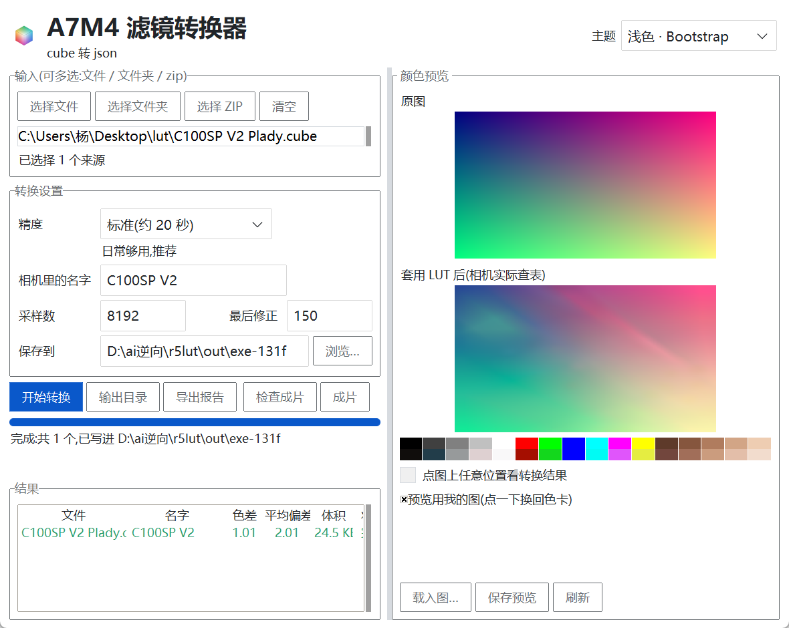

# A7M4 滤镜转换器（cube → camera-look JSON）

把调色用的 `.cube` LUT，转成索尼 **A7M4** 机内「创意外观（camera-look）」认识的 JSON
（`PRIVATE/M4ROOT/GENERAL/LUT/*.json`，机内 16 槽）。照片直出即可所见即所得，
不用回到电脑上调色。

> 适用范围：机内创意外观只作用在**照片 / 普通显示链路**。视频模式下的 PP 值
> 不在这套机制里，所以它和 S-Log3 的高动态范围不兼容 —— 想要风格化就用普通模式
> 直出（丢掉 log 的宽容度和后期空间），想要 log 就别套风格。



## 它解决什么

A7M4 的机内外观不是 `.cube`，而是一个 `camera-look v2` 的 JSON：里面不是一张 LUT 表，
而是 405 个整数参数（`parameters.grid`，3×5×9×9）。相机把这张网格烘焙成 129³ 的表，
再用三线性插值出画面。所以「把 cube 塞进相机」不是格式转换，而是**反解**：

> 找一组 405 个整数，让相机的烘焙 + 查表路径输出，尽量等于 cube 的结果。

本工具就是做这个反解：用官方训练资产里冻结的响应模型（`models/`），把相机真实路径
写成可微形式，再拟合 405 个参数。**优化目标就是相机真实的 129³ 表 + 三线性插值**，
与官方 `bake + sample` 逐位一致（mae8 0.00）。

## 精度

| 组 | 数量 | ΔE00 中位 | 最好 | 最差 |
|---|---|---|---|---|
| 彩色 look（输出普通显示） | 71 | **1.32** | 0.56 | — |
| 理光 GR 全套 Rec709 | 13 | **0.57** | 0.35 | 1.17 |
| 理光 GR 全套 SLog3 输入 LUT | 13 | **1.21** | 0.30 | 1.64 |
| 索尼官方 SLog3 四款 | 4 | 1.26 | 1.11 | 1.53 |

黑白/低彩度 LUT 会自动换成 ACROS 起点（中性起点拟不出整块去色）。

## 怎么用

### 图形界面

下载 Release 里的 `A7M4LUT.exe`，双击：

1. 选 `.cube`（支持多文件 / 文件夹 / ZIP）
2. 填相机里显示的名字
3. 选保存位置，点「开始转换」
4. 把输出文件夹里的 `PRIVATE/` 整个拷到 SD 卡根目录，插卡即认

右侧「颜色预览」是原图 / 相机实际查表后的画面 / 色块对照，点图能读任意点的转换结果。
中间那条缝可以拖动，预览栏能拉宽。

### 命令行

```bat
A7M4LUT.exe m4 --cube X.cube --name "我的外观" -o out\look
:: 整批
A7M4LUT.exe m4-batch --lut-dir .\cubes -o out\batch --table-steps 150
```

### 源码

```bat
py -3 -m pip install numpy torch ttkbootstrap pillow
set PYTHONPATH=%CD%\src
py -3 -m r5lut.m4gui
```

需要 `models/` 与 `charts/`（官方 M4 训练资产，不随仓库分发，见下文「资产」）。

## 输出

相机直接出**普通显示（Rec709）**画面，和 cube 在电脑上看到的一致。

拟合误差在显示域上算，报出来的数字就是肉眼看到的差别。

## 资产

`models/`、`charts/`、`native16/` 来自索尼官方的 M4 训练资产包，
**版权归索尼，不在本仓库分发**。可从
[M4 LUT training assets](https://github.com/Erlla/sony-a7m4-custom-firmware) 获取，
或用界面「显示更多设置 → 模型数据」指向本地目录。

## 格式规范

- [docs/A7M4格式.md](docs/A7M4格式.md) —— camera-look v2 字段、哈希、编码规则
- [docs/JSON格式说明.md](docs/JSON格式说明.md) —— A7R V 固件 JSON（另一个相机，别混）
- [docs/使用说明.md](docs/使用说明.md) —— 界面逐步说明

## 许可

本仓库代码 MIT，见 [LICENSE](LICENSE)。
`engine/`（A7R V 侧训练引擎）是
[Hearts-Ace/sony-r5-colorlab](https://github.com/Hearts-Ace/sony-r5-colorlab) 的 vendored
副本，**AGPL-3.0**，见 [engine/VENDORED-NOTES.md](engine/VENDORED-NOTES.md) 与
[THIRD_PARTY.md](THIRD_PARTY.md)。

引用到的上游：

- [Erlla/sony-a7m4-custom-firmware](https://github.com/Erlla/sony-a7m4-custom-firmware) —— camera-look v2 编解码与响应模型
- [Hearts-Ace/sony-a7r5-custom-firmware](https://github.com/Hearts-Ace/sony-a7r5-custom-firmware) / [sony-r5-colorlab](https://github.com/Hearts-Ace/sony-r5-colorlab) —— A7R V 侧方法与训练引擎（AGPL-3.0）

## 免责

非索尼官方工具。改机内外观属于自行承担风险的操作，请先备份相机设置、保留原始 LUT。
